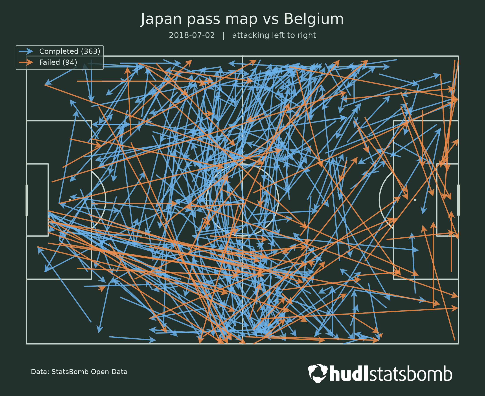
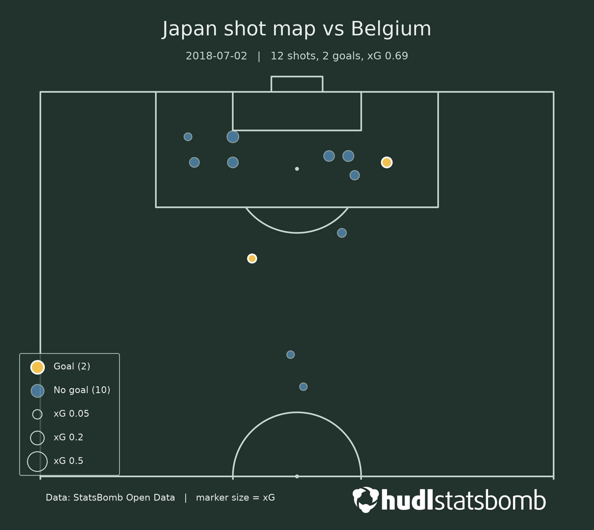

# PitchViz

[StatsBomb Open Data](https://github.com/statsbomb/open-data) を使って、サッカー日本代表の**パスマップ**と**ショットマップ**(xG をマーカーの大きさで表示)をピッチ上に描き、PNG で保存する Python ツールです。

| パスマップ | ショットマップ |
|---|---|
|  |  |

*例:2018-07-02 Belgium vs Japan(`match_id` 7584)*


**[アプリを開く](https://pitchviz-japan.streamlit.app)**(試合と選手を選ぶと、パスマップとショットマップが表示されます)

## できること

- 試合(`match_id`)とチーム名を指定して、**1行で**パスマップとショットマップを保存する
- 選手名を指定して、その選手だけのパスマップ・ショットマップを保存する
- ショットマップは、シュート1本ごとの xG(ゴールの期待値)をマーカーの大きさで表し、ゴールを色で区別する

## インストール

動作確認した環境:macOS、Python 3.13.3、VS Code

```bash
git clone https://github.com/あなたのユーザー名/pitchviz.git
cd pitchviz
python3 -m venv .venv
source .venv/bin/activate
pip install -r requirements.txt
pip install -e .
```

### ロゴ画像(任意)

StatsBomb のロゴ画像は、このリポジトリには**含まれていません**。図の右下にロゴを入れるには、[Media Pack](https://statsbomb.com/media-pack/) から、白1色のロゴをダウンロードして、次の場所に置いてください。

```
assets/statsbomb_logo_white.png
```

置かない場合は、`[warn] logo not found: ...` と表示され、ロゴなしで保存されます。**作った画像を公開・共有する場合は、下の「データとクレジット」に従って、StatsBomb のロゴで出典を示してください。**

## 使い方

```python
from pitchviz import make_maps, make_shot_map, list_players

# パスマップとショットマップを、1行で保存する(outputs/ に保存される)
paths = make_maps(7584, "Japan", match_date="2018-07-02")
print(paths)

# 選手を指定する(選手名は list_players で確認する)
make_shot_map(7584, "Japan", player_name="Genki Haraguchi", match_date="2018-07-02")
```

- 画像は、`outputs/` に `pass_map_<チーム>_<相手>.png`、`shot_map_<チーム>_<相手>.png` の名前で保存されます。
- `match_id` とチーム名は、次のようにして調べられます。

```python
from pitchviz.loader import get_competitions, get_team_matches

matches = get_team_matches(get_competitions("World Cup"), "Japan")
print(matches[["match_id", "match_date", "home_team", "away_team"]])
```

## 主な関数

| 関数 | 何をするか | 返すもの |
|---|---|---|
| `make_pass_map(match_id, team_name, player_name=None, match_date=None, ...)` | パスマップを保存する | 保存先のパス |
| `make_shot_map(match_id, team_name, player_name=None, match_date=None, ...)` | ショットマップを保存する | 保存先のパス |
| `make_maps(match_id, team_name, player_name=None, match_date=None, ...)` | 上の2つを続けて実行する | 保存先のパスのリスト |
| `list_players(events, team_name)` | そのチームの選手名の一覧 | 選手名のリスト |

## データとクレジット

This project uses StatsBomb Open Data.
Data source: [StatsBomb](https://github.com/statsbomb/open-data)

If you publish, share or distribute any research, analysis or insights based on this data, please state the data source as StatsBomb and use their logo, available in the [Media Pack](https://statsbomb.com/media-pack/).

本プロジェクトは StatsBomb Open Data を使用しています。

- **データは、このリポジトリに含まれていません。** 実行時に、StatsBomb の公開リポジトリから取得します。
- StatsBomb のデータから作った分析・画像を公開・共有する場合は、**StatsBomb のロゴで出典を示してください**。
- 利用条件は、公式リポジトリの `LICENSE.pdf`(StatsBomb Public Data User Agreement)を必ず確認してください。

## 免責・注意

- このプロジェクトは、**個人の学習目的の非公式のもの**で、StatsBomb(Hudl)とは関係がありません。
- データまたはデータから作った分析の**商業的な利用は、StatsBomb の利用条件で禁止されています**。このプロジェクトは非営利です。
- データの正確さ・完全さは保証されません。画像は、StatsBomb の見解を示すものではありません。

## ライセンス

コードは MIT License です(`LICENSE` を参照)。**データ・StatsBomb のロゴ・サンプル画像は対象外**で、StatsBomb の利用条件に従います。

## フォルダ構成

```
pitchviz/
├── src/pitchviz/     # 本体(loader.py: データ取得 / pass_map.py / shot_map.py / api.py: 入口の関数)
├── notebooks/        # 試作・動作確認の Notebook
├── docs/             # 作業手順書と、README 用のサンプル画像(docs/images/)
├── outputs/          # 生成した画像の保存先(Git の対象外)
├── assets/           # ロゴ画像の置き場(Git の対象外)
├── pyproject.toml
└── requirements.txt
```


